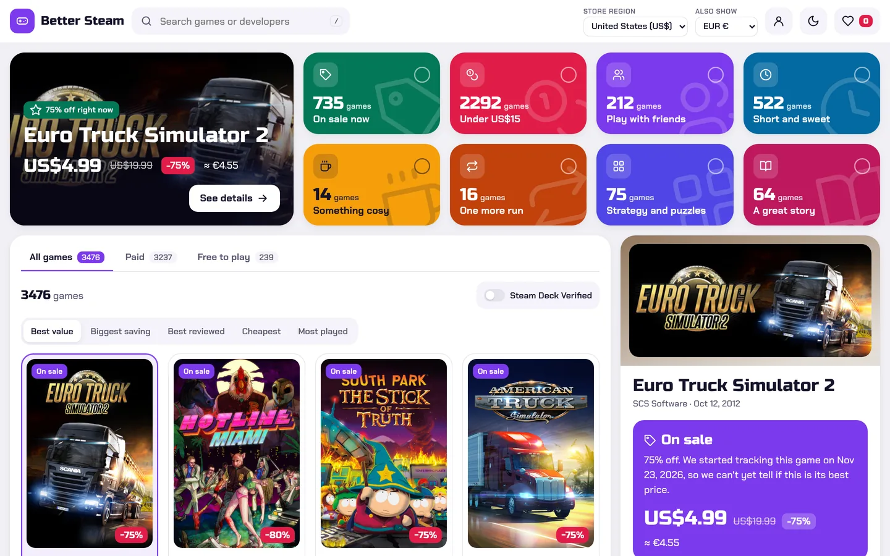
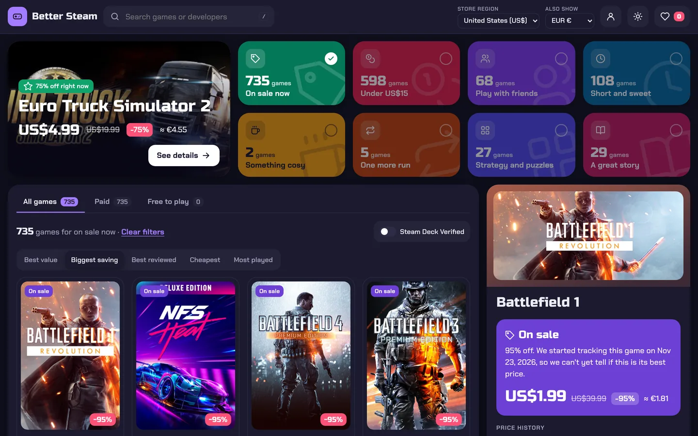
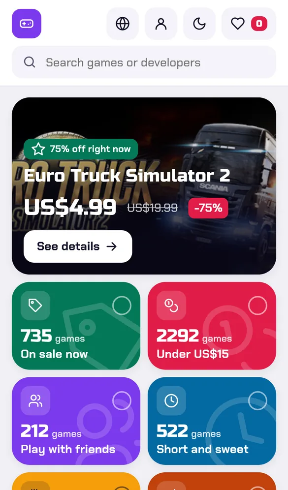
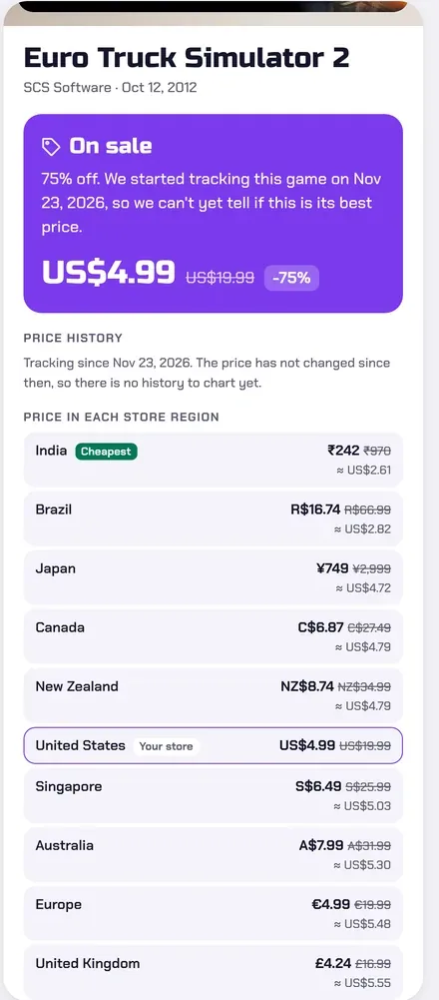
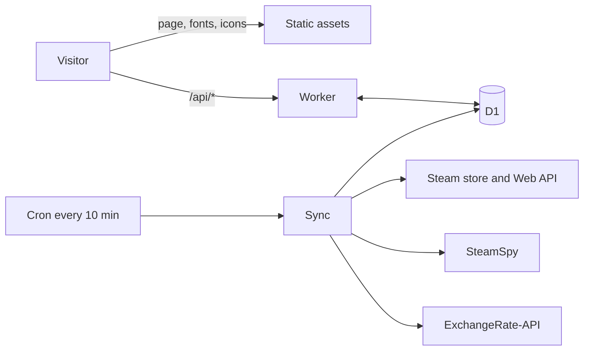

# Better Steam

**A calmer, clearer way to find Steam games worth buying.**

Pick a mood, see the real Steam price in your store region, and get a plain answer on whether today is a good day to buy.

**Live site: [steam.nayeemdev.com](https://steam.nayeemdev.com)**

[](https://github.com/nayeemdev/better-steam/actions/workflows/ci.yml)
[](LICENSE)



Purchases always happen on Steam. Better Steam only links to each game's store page.

## Why

The Steam store makes it hard to find anything and harder to tell a good deal from a constant one. Filters are scattered, discounts do not say whether a price is actually low, and every page competes for attention. Better Steam keeps one screen, a handful of moods, and a single verdict per game.

## Features

**Finding games**

- **Mood tiles**: On sale now, Under $15, Play with friends, Short and sweet, Something cosy, One more run, Strategy and puzzles, A great story. Each shows how many games match, and they combine.
- **All games, Paid and Free to play tabs**, plus a Steam Deck Verified switch and five sort orders.
- **Genres**: pick one or more of ten broad genres (Action, RPG, Strategy, Simulation and more, each grouping related Steam tags) with live counts, and see games from any of them.
- **Search that understands short names**: `gta5`, `cod mw4`, `fh6` and `rdr2` find their games, with Roman numerals read as numbers. Games not tracked yet come from Steam's own search with a store link.
- **Similar games** in each preview, matched on shared tags and weighted toward good reviews and current discounts.
- **Steam profile** (no sign in): paste a profile link to filter by your public wishlist and hide games you own.

**Judging the price**

- **One verdict per game**: Lowest price yet, Good price, On sale, Wait for a sale, Never discounted, Full price or Free to play, from the prices we have tracked.
- **Real regional prices** for 10 Steam store regions (US by default), with a second currency set from your location and hidden when it matches.
- **Price in every region** for each game, converted to your currency with the cheapest marked.
- **Price history chart**, price drop alerts for watched games, and a banner when a big Steam sale looks to be on.

**Everyday use**

- Light and dark themes, phone layout with a bottom sheet preview, arrow key browsing and `/` to search.
- Filters, sort, tab and the open game live in the URL, so any view can be shared, and shared game links get a rich preview card.
- Installable as an app and usable offline with the last loaded games.

## Screenshots

<table>
  <tr>
    <td colspan="2"></td>
  </tr>
  <tr>
    <td colspan="2" align="center"><sub>Dark mode, filtered to games on sale and sorted by biggest saving</sub></td>
  </tr>
  <tr>
    <td width="50%" align="center"></td>
    <td width="50%" align="center"></td>
  </tr>
  <tr>
    <td align="center"><sub>Phone layout</sub></td>
    <td align="center"><sub>A game's price in all 10 store regions, cheapest first</sub></td>
  </tr>
</table>

## Design

Better Steam is built as the opposite of a busy storefront: one screen, a few clear choices and no visual noise.

- **Bento layout**: a grey canvas with white panels. The featured deal and eight colour-block mood tiles sit on top, with the cover grid and a sticky game preview below, so browsing never leaves the page.
- **One answer per game**: each card leads with its cover, a verdict badge and the price. The preview explains the verdict in one sentence before showing price history and regional prices.
- **Colour with meaning**: each mood has its own colour and icon, and verdicts keep consistent colours (green for the lowest price, amber for a good price, purple for a sale, grey for wait, teal for free). The rest of the interface stays neutral so game covers carry the colour.
- **Typography**: Russo One for headings and prices, Chakra Petch for everything else, both served from the site.
- **Calm by default**: light theme first with a dark theme toggle, no hover glow, zoom or lift effects, nothing that autoplays, and placeholders while covers and details load.
- **Accessible**: readable contrast in both themes, visible keyboard focus, arrow key navigation, touch targets of at least 44 px, and reduced motion respected.
- **Made for phones too**: a compact header with prices in a dialog, two-column covers, and the preview as a bottom sheet.

## How it works

The whole app is one Cloudflare Worker with a D1 database, running on the free plan.



- **Sync**: a cron trigger runs every 10 minutes and, within the free plan's 50 outbound requests per run, refreshes:
  - prices for the next 2,250 game and region pairs, continuing where the last run stopped (each region about every three hours)
  - details for 10 games (description, tags, co-op, Steam Deck status) and image paths for 100 games
  - one page of the catalogue (Steam's top 500 sellers, then SteamSpy's top 5,000 most owned games) and exchange rates once a day
- **Writes stay small**: prices are only written when they change, which keeps D1 well under its 100,000 daily row writes.
- **Reads stay small**: the order of games to price and each region's last seen prices are kept as single rows, so a sync run reads a handful of rows instead of thousands, and the other queues use partial indexes. Filters and searches in the browser never call the database.
- **Caching**: API responses are cached at Cloudflare's edge for an hour and in browsers for 5 minutes. Game details are cached in the page.
- **Honest verdicts**: until a game has 30 days of tracked history, a discount is shown as "On sale" rather than claiming a record low.

### Tech stack

| Part | Choice |
| --- | --- |
| Hosting | Cloudflare Workers with static assets, cron triggers and the rate limiting binding |
| Database | Cloudflare D1 (SQLite) |
| Server | TypeScript, no framework |
| Frontend | Plain HTML, CSS and JavaScript modules, no build step |
| Tests | Node's built-in test runner |
| CI | GitHub Actions (tests and type check) |
| Deploys | Cloudflare Workers Builds from `main` |

### Data sources

| Data | Source |
| --- | --- |
| Catalogue | Steam top sellers and [SteamSpy](https://steamspy.com/api.php) most owned |
| Review counts, median playtime, tags | [SteamSpy](https://steamspy.com/api.php) |
| Descriptions, co-op, regional prices | Steam store `appdetails` |
| Steam Deck compatibility | Steam store Deck report |
| Cover and header image paths | Steam `IStoreBrowseService/GetItems` |
| Exchange rates | [ExchangeRate-API open access](https://www.exchangerate-api.com/docs/free) |
| Wishlist and owned games | Steam community profile and Steam Web API |

### API

| Route | Returns |
| --- | --- |
| `GET /api/games?region=US` | Every listed game with its price and verdict in that region |
| `GET /api/games/:id?region=US` | One game's description, tags, price history and price in every region |
| `GET /api/meta` | Store regions, currencies with rates, and a default second currency from the visitor's country |
| `GET /api/search?q=<text>&region=US` | Steam store search, for games the catalogue does not track yet |
| `GET /api/profile?id=<link or ID>` | A Steam profile's public wishlist, and owned games when a Steam Web API key is set |
| `GET /api/status` | Sync progress: last run and any failed steps, catalogue, details and image coverage, prices per region |

Search and profile lookups call Steam directly, so each visitor IP gets 30 of them per minute.

## Project structure

```
src/
  index.ts      Worker entry: API routes, home page link previews, cron
  api.ts        API handlers and caching
  sync.ts       Scheduled sync of catalogue, prices, details, images and rates
  steam.ts      Steam, SteamSpy and exchange rate clients
  pricing.ts    Deal verdicts and scoring
  regions.ts    Store regions and currencies
  share.ts      Link preview tags
public/         The site: index.html, app.js, styles.css, fonts, icons, service worker
migrations/     D1 schema
test/           Unit tests
```

## Run it yourself

Requires Node 22 or later.

```bash
npm install
```

```bash
npm run db:migrate:local
```

```bash
npx wrangler dev --test-scheduled
```

The sync does not run on its own locally. Trigger it, and repeat to fill in more games:

```bash
curl "http://localhost:8787/__scheduled?cron=*/10+*+*+*+*"
```

Checks:

```bash
npm test
```

```bash
npm run typecheck
```

### Deploy your own

1. Log in: `npx wrangler login`
2. Create the database: `npx wrangler d1 create better-steam`
3. Put the printed `database_id` in `wrangler.jsonc`.
4. Apply the schema: `npm run db:migrate`
5. Deploy: `npm run deploy`

For automatic deploys, connect the repository in the Cloudflare dashboard under **Workers & Pages → Create → Import a repository**, name the project `better-steam`, leave the build command empty and set the deploy command to `npm run db:migrate && npx wrangler deploy`. If the migration step fails, give the build's API token **D1 Edit** permission.

The first sync starts within ten minutes. Every game with a price is listed straight away, prices for all regions arrive within about three hours, and descriptions, tags and Steam Deck status fill in over about three days.

### Optional settings

- **Hide owned games**: wishlists work without a key. For owned games, get a key at <https://steamcommunity.com/dev/apikey> and run `npx wrangler secret put STEAM_API_KEY` (locally, put `STEAM_API_KEY=...` in `.dev.vars`).
- **Visitor analytics**: in the Cloudflare dashboard, open **Analytics & Logs → Web Analytics → Add a site**, pick your hostname and choose **Enable**. No code change is needed.
- **Browser caching**: set **Caching → Configuration → Browser Cache TTL** to **Respect Existing Headers** so the API's own cache times apply.

## Roadmap

- [x] Regional prices, verdicts and price history
- [x] Mood filters, tabs, short name search and similar games
- [x] Steam profile wishlist and owned games
- [x] Price drop alerts in the app, sale banner, link previews, installable app
- [ ] Email price alerts
- [ ] Accurate historical lows from day one (IsThereAnyDeal's API terms need their written permission for a site like this)

## Credits

Game data comes from Steam and [SteamSpy](https://steamspy.com), and exchange rates from [ExchangeRate-API](https://www.exchangerate-api.com). The Chakra Petch and Russo One fonts are used under the SIL Open Font License, included in `public/fonts`.

Better Steam is not affiliated with Valve. Steam and the Steam logo are trademarks of Valve Corporation. Game names and artwork belong to their owners.

## License

[MIT](LICENSE). The fonts in `public/fonts` keep their own SIL Open Font License.
